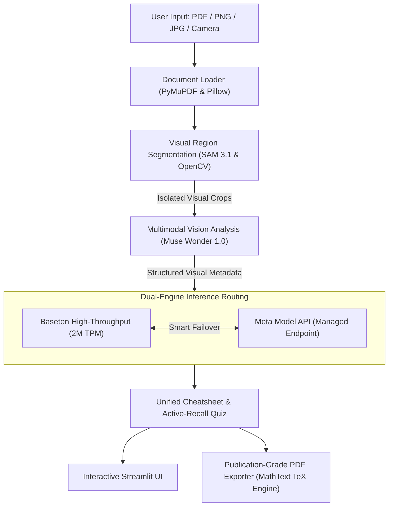

# 📐 VisualScribe

> **Automated Multimodal Technical Study Assistant & Cheatsheet Generator**  
> *Built for the Meta Global AI Developer Hackathon — Indie Developer Track*  
> *Powered by Meta SAM 3.1, Muse Wonder (`muse-wonder-1.0`), Muse Spark (`muse-spark-1.3`), and Baseten High-Throughput Inference (2M TPM)*

[](https://meta.ai)
[](https://baseten.co)
[](https://python.org)
[](https://streamlit.io)

---

## 🎯 The Problem

Students, engineers, and researchers study from dense slides, packet captures, textbook scans, and whiteboard photos. Existing AI study tools rely on standard text-only OCR that:
- ❌ **Flattens complex visual mechanics:** Directional flowcharts, Wireshark packet traces, circuit schematics, and biological cycles are scrambled into unreadable plain text.
- ❌ **Mangles mathematical expressions:** Formulas are dumped as broken ASCII code (`c = \sqrt{a^2+b^2}`) rather than true mathematical typography.
- ❌ **Hallucinates artificial math:** Generic tools force unrelated calculus equations onto non-mathematical documents (like networking logs or software architectures).

---

## 💡 The Solution: VisualScribe

**VisualScribe** is an end-to-end multimodal study engine that:
1. **Isolates Visual Elements:** Uses **Meta SAM 3.1** and morphological visual clustering to detect genuine diagrams, packet tables, and equation blocks while suppressing page margins and publisher logos.
2. **Deconstructs Visual Mechanics:** Uses **Muse Wonder (`muse-wonder-1.0`)** to inspect components, directional arrows, packet headers, and mathematical variables.
3. **Adapts Dynamically to Any Technical Domain:**
   - 🌐 **Computer Networks & IT:** Wireshark packet list panes, filter expressions (`http.host`), protocols (DNS, TCP, HTTP), and port mechanics.
   - 💻 **Software Architecture & Systems:** Flowcharts, data pipelines, state machines, and UML relationships.
   - 🧬 **Biology & Medicine:** Cellular mechanisms, reaction pathways, molecular structures, and organelle roles.
   - 📐 **Physics & Mathematics:** Equation derivations and coordinate plots with rigorous LaTeX transcription.
4. **Synthesizes High-Yield Master Cheatsheets:** Uses **Muse Spark (`muse-spark-1.3`)** or **Baseten (`meta-models/muse-spark-open-1026`)** with a 2M TPM rate limit to compile structured reference guides.
5. **Generates Active-Recall Quizzes:** Delivers interactive multiple-choice drills grounded strictly in the visual evidence, complete with instant scoring and pedagogical explanations.
6. **Compiles Publication-Grade PDFs:** Renders equations into vector-grade MathText graphics (true $\sqrt{}$ radicals, fraction bars, superscripts) and styled visual cards using PyMuPDF.

---

## 🏗️ System Architecture & Data Pipeline



---

## 🌟 Key Features

| Feature | Description |
| :--- | :--- |
| **Domain-Adaptive Synthesis** | Automatically identifies subject domain (networks, software, biology, math) with zero artificial math hallucination on non-math documents. |
| **High-Throughput Partner Engine** | Integrated with **Baseten** running `meta-models/muse-spark-open-1026` under a **2M TPM rate limit** with live sidebar switching and automated failover. |
| **2-Tier MathText PDF Engine** | Headless TeX typesetting renders true Computer Modern equations into transparent high-resolution graphics for downloadable PDFs. |
| **Live Latency Telemetry** | Displays real-time response latency and engine metadata directly in the UI and raw telemetry JSON. |
| **Hardware-Gated Camera Capture** | Camera hardware remains completely disabled until explicitly toggled, preserving user privacy. |
| **Multi-Page Navigator** | Seamlessly jump to and analyze any specific page in long slide decks or textbook PDFs. |
| **Study Focus Directives** | Guide the AI with custom instructions or 1-click preset chips (*"Rigorous Proofs"*, *"Exam-Style Quiz"*). |

---

## ⚡ Inference Speed Benchmark (Baseten vs. Meta)

VisualScribe includes a built-in benchmarking tool to compare latency and throughput side-by-side:

```powershell
python compare_providers.py
```

| Provider | Model | Latency | Throughput | Rate Limit |
| :--- | :--- | :--- | :--- | :--- |
| **Baseten** | `meta-models/muse-spark-open-1026` | **~3.8s** | **~64 words/s** | **2,000,000 TPM** |
| **Meta Model API** | `muse-spark-1.3` | ~25.2s | ~14 words/s | Shared Gateway |

---

## 🚀 Quickstart Guide

### 1. Clone the Repository & Install Dependencies
```powershell
git clone https://github.com/your-username/VisualScribe.git
cd VisualScribe
python -m venv .venv
.\.venv\Scripts\Activate.ps1
pip install -r requirements.txt
```

### 2. Configure Environment (`.env`)
Create a `.env` file in the root directory (refer to `.env.example`):
```ini
# Meta Model API Key
META_API_KEY=your_meta_api_key_here

# Baseten High-Throughput Inference (2M TPM)
BASETEN_API_KEY=your_baseten_api_key_here
BASETEN_BASE_URL=https://inference.baseten.co/v1
BASETEN_MODEL=meta-models/muse-spark-open-1026
LLM_PROVIDER=baseten
```

### 3. Run Pipeline Verification Test
Verify segmentation, vision analysis, LaTeX typesetting, and PDF generation:
```powershell
python tests/test_pipeline.py
```

### 4. Launch the Web Application
```powershell
streamlit run app.py
```
Open [http://localhost:8501](http://localhost:8501) in your browser.  
*(Tip: Click **"Load Demo Slide"** in the sidebar to test immediately with a Quantum Mechanics lecture slide!)*

---

## 📁 Repository Structure

```text
VisualScribe/
├── app.py                  # Streamlit Interactive Web Application
├── config.py               # Multi-provider client (Meta & Baseten failover, backoff)
├── compare_providers.py    # Side-by-side latency & throughput benchmark script
├── test_baseten.py         # Standalone Baseten diagnostic test
├── requirements.txt        # Pinned project dependencies
├── .env.example            # Template environment variables
├── core/
│   ├── pdf_loader.py       # PyMuPDF & Pillow document ingester
│   ├── segmenter.py        # SAM 3.1 & OpenCV visual contour clustering
│   ├── analyzer.py         # Muse Wonder multimodal vision deconstructor
│   ├── generator.py        # Domain-adaptive cheatsheet & quiz synthesis
│   └── exporter.py         # MathText vector engine, HTML & PDF compiler
└── tests/
    └── test_pipeline.py    # End-to-end integration & LaTeX verification test
```

---

## 🏆 Hackathon Tracks & Technologies

- **Hackathon Track:** Indie Developer Track
- **Core Models:**
  - **Meta SAM 3.1** (Segment Anything Model)
  - **Meta Muse Wonder (`muse-wonder-1.0`)** (Multimodal Vision & Diagram Reasoning)
  - **Meta Muse Spark (`muse-spark-1.3`)** (Conceptual STEM Synthesis)
  - **Meta Muse Spark Open (`meta-models/muse-spark-open-1026`)** (Open-Weights Reasoning)
- **Partner Ecosystem:**
  - **Baseten** (High-throughput inference with 2M TPM rate limit and dedicated routing)

---

## 📜 License
MIT License. Built for the Meta Global AI Developer Hackathon.
